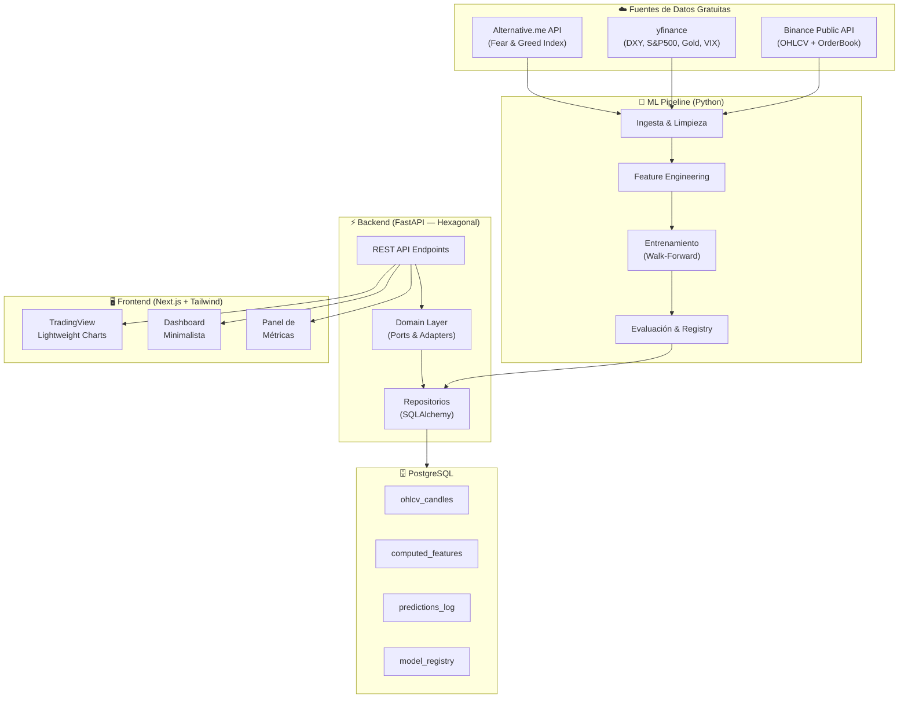
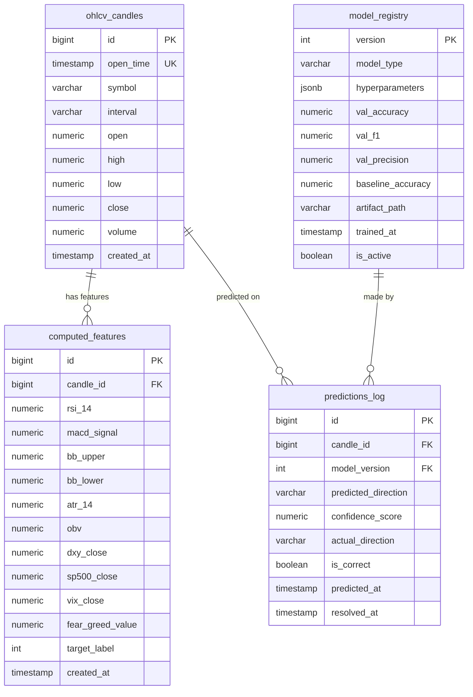
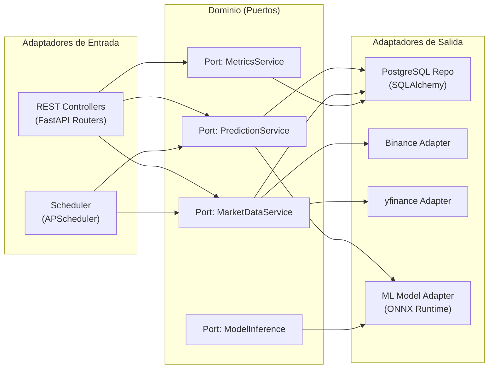
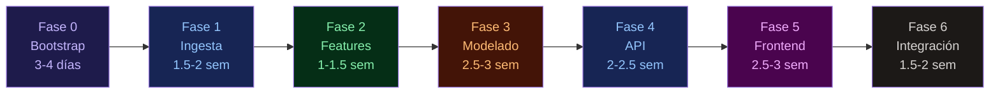

# 🏗️ Plan de Desarrollo: Plataforma de Predicción Direccional BTC

> **Proyecto:** BTC Direction Predictor — Full-Stack ML Platform  
> **Fecha:** 28 de octubre de 2026  
> **Duración Estimada:** 14–18 semanas (1 desarrollador senior) / 8–10 semanas (equipo de 3)  
> **Objetivo de Negocio:** Clasificación binaria UP/DOWN con accuracy realista del 55–60%

---

## Arquitectura General



---

## Modelo de Datos (PostgreSQL)



---

## Arquitectura Hexagonal del Backend



---

## FASE 0 — Bootstrapping & Infraestructura

> **Duración:** 3–4 días  
> **Objetivo:** Monorepo funcional, CI/CD local, y entornos reproducibles.

### Tareas

| # | Tarea | Detalle |
|---|-------|---------|
| 0.1 | Estructura del monorepo | Crear layout: `ml/`, `backend/`, `frontend/`, `infra/`, `shared/` |
| 0.2 | Entorno Python | `pyproject.toml` con Poetry o uv. Python ≥ 3.11 |
| 0.3 | Docker Compose | Servicios: `postgres:16`, `pgadmin`, `backend`, `ml-worker` |
| 0.4 | Migraciones DB | Alembic configurado con las 4 tablas del modelo de datos |
| 0.5 | Frontend scaffolding | `npx create-next-app@latest` con TypeScript + Tailwind CSS v4 |
| 0.6 | Pre-commit hooks | Ruff (lint + format), mypy, ESLint, Prettier |
| 0.7 | Variables de entorno | `.env.example` con Pydantic Settings en backend |

### Librerías Clave

| Componente | Paquetes |
|------------|----------|
| Python ML | `pandas`, `numpy`, `scikit-learn`, `pytorch` (o `tensorflow`), `ta-lib` o `pandas-ta` |
| Backend | `fastapi`, `uvicorn`, `sqlalchemy[asyncio]`, `asyncpg`, `alembic`, `pydantic`, `apscheduler` |
| Frontend | `next`, `react`, `tailwindcss`, `lightweight-charts`, `axios` o `swr`, `zustand` |

### Estructura de Directorios Propuesta

```
btc-predictor/
├── ml/
│   ├── src/
│   │   ├── ingestion/          # Conectores a APIs externas
│   │   ├── features/           # Feature engineering pipeline
│   │   ├── training/           # Walk-forward training loop
│   │   ├── evaluation/         # Métricas, baseline comparison
│   │   └── export/             # Exportación ONNX
│   ├── notebooks/              # EDA y prototipado
│   ├── tests/
│   └── pyproject.toml
├── backend/
│   ├── src/
│   │   ├── domain/             # Entidades, puertos (interfaces ABC)
│   │   ├── application/        # Casos de uso / servicios
│   │   ├── adapters/
│   │   │   ├── inbound/        # FastAPI routers
│   │   │   └── outbound/       # Repos, API clients, ML adapter
│   │   └── config/             # Settings, DI container
│   ├── migrations/             # Alembic
│   ├── tests/
│   └── pyproject.toml
├── frontend/
│   ├── src/
│   │   ├── app/                # Next.js App Router
│   │   ├── components/         # UI components
│   │   ├── hooks/              # Custom hooks (SWR, WebSocket)
│   │   ├── lib/                # API client, utils
│   │   └── styles/             # Tailwind config, globals
│   ├── package.json
│   └── tsconfig.json
├── infra/
│   ├── docker-compose.yml
│   └── scripts/                # DB seed, cron setup
└── README.md
```

> [!IMPORTANT]
> Definir desde el inicio la granularidad temporal del sistema. Recomendación: **velas de 4h** como horizonte primario. Los intervalos de 1m/5m tienen demasiado ruido para un modelo de clasificación con features macroeconómicas que se actualizan diariamente. Las velas diarias reducen demasiado el dataset de entrenamiento.

---

## FASE 1 — Ingesta y Limpieza de Datos

> **Duración:** 1.5–2 semanas  
> **Objetivo:** Pipeline robusto de ingesta con datos limpios almacenados en PostgreSQL.

### Tareas

| # | Tarea | Detalle |
|---|-------|---------|
| 1.1 | Conector Binance OHLCV | `GET /api/v3/klines` — paginar histórico completo (~3+ años de velas 4h). Respetar rate limits (1200 req/min). Implementar retry con backoff exponencial. |
| 1.2 | Conector yfinance | Descargar series de `DX-Y.NYB` (DXY), `^GSPC` (S&P 500), `^VIX`, `GC=F` (Gold). Alinear por timestamp con merge asof. |
| 1.3 | Conector Fear & Greed Index | `GET https://api.alternative.me/fng/?limit=0&format=json`. Caché diario. Mapear a timestamp UTC. |
| 1.4 | Pipeline de limpieza | Detección de gaps temporales, interpolación de missing values en OHLCV (forward-fill máximo 1 período), validación de rangos (close > 0, volume ≥ 0). |
| 1.5 | Almacenamiento en PostgreSQL | Bulk upsert con `ON CONFLICT DO NOTHING`. Índices en `(symbol, interval, open_time)`. Particionamiento por rango temporal si el dataset supera 500K rows. |
| 1.6 | Scheduler de actualización | APScheduler o cron que ingeste las últimas N velas cada 4h. Idempotente. |
| 1.7 | Tests de integridad | Assertions: sin duplicados, continuidad temporal, completitud > 99.5%. |

### Librerías Específicas

```
httpx              # Cliente async para Binance API
yfinance           # Yahoo Finance wrapper
pandas             # Manipulación de DataFrames
asyncpg            # Driver PostgreSQL async
sqlalchemy[asyncio] # ORM async
```

> [!WARNING]
> **Cuello de Botella — Alineación Temporal Multi-Fuente:**  
> Los datos macro de Yahoo Finance tienen resolución diaria y solo se actualizan en horario bursátil (lunes–viernes). Bitcoin opera 24/7. Solución: usar `pd.merge_asof()` con tolerancia de 24h y forward-fill. **Documentar explícitamente** que features macro tendrán un retraso intrínseco de hasta 24h. Esto NO es data leakage porque refleja la realidad operativa (un trader humano tampoco tiene el VIX del domingo).

> [!CAUTION]
> **Data Leakage Potencial en la Ingesta:**  
> Nunca usar el cierre de la vela actual como feature para predecir la dirección de esa misma vela. El target `y[t]` debe definirse como `sign(close[t+1] - close[t])`, y las features `X[t]` solo deben usar información disponible hasta `close[t]` (inclusive). Verificar esto con un test unitario.

---

## FASE 2 — Feature Engineering

> **Duración:** 1–1.5 semanas  
> **Objetivo:** Construir un vector de ~25–40 features con significado financiero, almacenado en `computed_features`.

### Tareas

| # | Tarea | Detalle |
|---|-------|---------|
| 2.1 | Indicadores técnicos de precio | RSI(14), MACD(12,26,9), Bandas de Bollinger(20,2), EMA(9), EMA(21), EMA(50), SMA(200) |
| 2.2 | Indicadores de volatilidad | ATR(14), Bollinger Band Width, Historical Volatility (20 períodos), rango High-Low normalizado |
| 2.3 | Indicadores de volumen | OBV, VWAP (si es intradiario), Volume SMA ratio, Accumulation/Distribution |
| 2.4 | Features de momentum | ROC(5), ROC(10), Williams %R, Stochastic RSI |
| 2.5 | Features de estructura de mercado | Distancia precio-EMA(50) normalizada, pendiente de EMA(21) sobre 5 períodos, higher-highs/lower-lows count |
| 2.6 | Features macroeconómicas | DXY change %, S&P 500 change %, VIX nivel absoluto, Gold change %, correlación rolling BTC–S&P(20d) |
| 2.7 | Features de sentimiento | Fear & Greed Index valor, FGI SMA(7), FGI momentum |
| 2.8 | Features temporales | Hora del día (sin encoding cíclico), día de la semana (one-hot), es fin de semana (binary) |
| 2.9 | Construcción del target | `y[t] = 1 if close[t+1] > close[t] else 0`. Eliminar la última fila (sin target conocido). |
| 2.10 | Selección de features | Calcular correlación con target, eliminar features con correlación < 0.02. Mutual Information Score. Eliminar features colineales (VIF > 10 o corr > 0.95). |
| 2.11 | Persistencia | Guardar features computadas en tabla `computed_features`. Pipeline idempotente y reproducible. |

### Librerías Específicas

```
pandas-ta          # 130+ indicadores técnicos (alternativa: ta-lib con wrapper)
scipy              # Estadísticas, correlaciones
statsmodels        # VIF (Variance Inflation Factor)
```

> [!NOTE]
> **Decisión Arquitectural — Cálculo de Features:**  
> Las features deben calcularse como un pipeline offline (batch) que se ejecuta después de cada ingesta. NO calcularlas on-the-fly en el backend de la API para evitar inconsistencias y overhead computacional. El backend solo lee features pre-calculadas de PostgreSQL.

> [!WARNING]
> **Cuello de Botella Matemático — Lookahead Bias en Indicadores:**  
> Algunos indicadores técnicos usan ventanas centradas por defecto (ej: ciertas implementaciones de Bollinger Bands). Asegurar que **todos** los indicadores usen ventanas exclusivamente retrospectivas (lookback). Validar con un test que compara el cálculo incremental (fila por fila) contra el cálculo vectorizado. Si difieren, hay lookahead.

---

## FASE 3 — Modelado y Validación con Walk-Forward

> **Duración:** 2.5–3 semanas  
> **Objetivo:** Modelo de clasificación binaria validado rigurosamente, exportado como artefacto ONNX.

### Tareas

| # | Tarea | Detalle |
|---|-------|---------|
| 3.1 | Baseline ingenuo | Implementar 3 baselines: (a) "siempre sube" (class majority), (b) predicción = dirección del período anterior, (c) random ponderado por distribución de clases. Registrar accuracy de cada uno. |
| 3.2 | Pipeline de preprocesamiento | `StandardScaler` fit solo en train, transform en train+val+test. Imputación de NaN residuales. Guardar scaler como artefacto. |
| 3.3 | Walk-Forward Validation | Ver diagrama abajo. Mínimo 10 folds con expanding window. Train: ≥1 año. Validation: 1 mes. |
| 3.4 | Modelo 1: Gradient Boosting | XGBoost o LightGBM. Grid search sobre `max_depth`, `learning_rate`, `n_estimators`, `subsample`. |
| 3.5 | Modelo 2: Red Neuronal (LSTM/Transformer) | PyTorch LSTM con 2 capas, hidden_size=64, dropout=0.3. Sequence length = 20 períodos. O Temporal Fusion Transformer si el equipo tiene experiencia. |
| 3.6 | Modelo 3 (Opcional): Ensemble | Voting o Stacking de Modelo 1 + Modelo 2. |
| 3.7 | Métricas de evaluación | Accuracy, F1 (macro), Precision/Recall por clase, AUC-ROC, Log Loss. **Comparar TODAS contra baselines.** |
| 3.8 | Análisis de calibración | Calibration curve (reliability diagram). Si el modelo dice 70% UP, ¿realmente sube 70% de las veces? Aplicar Platt Scaling o Isotonic Regression si es necesario. |
| 3.9 | Feature Importance | SHAP values para XGBoost. Gradientes para LSTM. Verificar que ninguna feature domine >50% de importancia (señal de leakage). |
| 3.10 | Exportación del modelo | Convertir a ONNX para inferencia rápida y desacoplada del framework. Guardar metadata en `model_registry`. |
| 3.11 | Tests de regresión del modelo | Dado un input fijo, la predicción debe ser determinista (seed fija). Test que valida accuracy > baseline + 2% en el último fold. |

### Walk-Forward Validation — Diagrama

```mermaid
flowchart LR
    subgraph Fold1["Fold 1"]
        T1["Train\n2023-01 → 2024-01"]
        V1["Val\n2024-01 → 2024-02"]
    end
    subgraph Fold2["Fold 2"]
        T2["Train\n2023-01 → 2024-02"]
        V2["Val\n2024-02 → 2024-03"]
    end
    subgraph Fold3["Fold 3"]
        T3["Train\n2023-01 → 2024-03"]
        V3["Val\n2024-03 → 2024-04"]
    end
    subgraph FoldN["Fold N ..."]
        TN["Train\n2023-01 → 2026-08"]
        VN["Val\n2026-08 → 2026-09"]
    end

    Fold1 --> Fold2 --> Fold3 --> FoldN

    style T1 fill:#1a3a2a,color:#4ade80
    style T2 fill:#1a3a2a,color:#4ade80
    style T3 fill:#1a3a2a,color:#4ade80
    style TN fill:#1a3a2a,color:#4ade80
    style V1 fill:#3a1a1a,color:#f87171
    style V2 fill:#3a1a1a,color:#f87171
    style V3 fill:#3a1a1a,color:#f87171
    style VN fill:#3a1a1a,color:#f87171
```



> La ventana de entrenamiento se **expande** en cada fold. Nunca se usa información futura para entrenar.

### Librerías Específicas

```
scikit-learn       # Baselines, preprocessing, métricas
xgboost / lightgbm # Gradient Boosting
torch              # LSTM / Transformer
onnx + onnxruntime # Exportación e inferencia
shap               # Interpretabilidad
matplotlib         # Calibration curves, visualización de métricas
```

> [!CAUTION]
> **Cuello de Botella Crítico — Overfitting en Series Temporales:**  
> - **PROHIBIDO** usar `sklearn.model_selection.cross_val_score` con `KFold` estándar. Mezcla pasado y futuro.  
> - **OBLIGATORIO** usar `TimeSeriesSplit` o un walk-forward custom.  
> - Si el accuracy en train es >70% pero en validation es <52%, el modelo está sobreajustado. Reducir complejidad.  
> - Si accuracy ≈ 50% en todos los folds, el modelo no tiene señal. Revisar features o cambiar el horizonte temporal.

> [!WARNING]
> **Cuello de Botella Matemático — Desbalanceo de Clases:**  
> BTC no sube/baja 50/50. Periodos alcistas pueden tener 60–65% de velas UP. Medir la distribución por fold. Si el desbalanceo es >60/40, usar `class_weight='balanced'` en el modelo o SMOTE solo en el training set de cada fold (NUNCA en validación).

> [!TIP]
> **Expectativa Realista de Performance:**  
> Un accuracy consistente del **55–58%** en walk-forward sobre 10+ folds es un resultado **excelente** para predicción de BTC. No perseguir 60%+ porque probablemente indica leakage. La clave no es solo el accuracy sino el **profit factor**: si cuando acierta gana más de lo que pierde cuando falla (combinando con sizing o stop-loss), el sistema es viable.

---

## FASE 4 — Construcción de la API (FastAPI + Hexagonal)

> **Duración:** 2–2.5 semanas  
> **Objetivo:** API REST desacoplada que sirve predicciones, datos de mercado y métricas históricas.

### Tareas

| # | Tarea | Detalle |
|---|-------|---------|
| 4.1 | Definir Puertos (Interfaces) | `PredictionPort`, `MarketDataPort`, `ModelInferencePort`, `MetricsPort` como clases ABC en `domain/ports/`. |
| 4.2 | Implementar Entidades de Dominio | `Candle`, `Feature`, `Prediction`, `ModelMetadata` como Pydantic models inmutables en `domain/entities/`. |
| 4.3 | Implementar Adaptador ML | Cargar modelo ONNX con `onnxruntime`. Exponer `predict(features: FeatureVector) -> PredictionResult`. |
| 4.4 | Implementar Repositorios PostgreSQL | AsyncSession + SQLAlchemy 2.0 style. Repos: `CandleRepository`, `FeatureRepository`, `PredictionRepository`. |
| 4.5 | Implementar Servicios de Aplicación | `PredictionService.get_current_prediction()`, `MarketDataService.get_candles(symbol, interval, limit)`, `MetricsService.get_historical_accuracy()`. |
| 4.6 | Implementar Routers FastAPI | Mapear endpoints (ver tabla abajo). Dependency Injection con `Depends()` para inyectar puertos. |
| 4.7 | WebSocket para actualizaciones | Endpoint WS para push de nuevas predicciones y precio. Heartbeat cada 30s. |
| 4.8 | Middleware & CORS | Rate limiting, CORS para frontend, request logging, error handling centralizado. |
| 4.9 | Health check & observabilidad | `/health`, `/readiness`, endpoint de métricas Prometheus (opcional). |
| 4.10 | Scheduler integrado | APScheduler dentro de FastAPI lifecycle. Job: cada 4h → ingesta → features → predicción → almacenar. |
| 4.11 | Tests de API | `httpx.AsyncClient` + `pytest-asyncio`. Mocking de adaptadores. 80%+ coverage en servicios. |

### Endpoints de la API

| Método | Ruta | Descripción | Response |
|--------|------|-------------|----------|
| `GET` | `/api/v1/candles` | OHLCV paginado | `{ data: Candle[], pagination }` |
| `GET` | `/api/v1/candles/latest` | Última vela + variación | `Candle` |
| `GET` | `/api/v1/predictions/current` | Predicción activa | `{ direction, confidence, model_version, timestamp, status: "experimental" \| "validated" }` |
| `GET` | `/api/v1/predictions/history` | Historial de predicciones | `{ data: Prediction[], pagination }` |
| `GET` | `/api/v1/metrics/accuracy` | Accuracy histórico y por período, siempre junto al baseline | `{ overall, baseline_overall, last_30d, last_7d, by_month[] }` |
| `GET` | `/api/v1/metrics/model` | Metadata y estado de validación del modelo | `{ version, type, val_accuracy, best_baseline_accuracy, beats_baseline, status, evidence_url, trained_at }` |
| `GET` | `/api/v1/features/latest` | Features actuales (transparencia) | `{ features: Record<string, number> }` |
| `WS` | `/ws/live` | Stream de precio y predicciones | `{ type: "candle" \| "prediction", data }` |

### Inyección de Dependencias (Hexagonal)

```python
# domain/ports/prediction_port.py
from abc import ABC, abstractmethod

class PredictionPort(ABC):
    @abstractmethod
    async def get_current(self) -> PredictionResult: ...
    
    @abstractmethod
    async def get_history(self, limit: int) -> list[PredictionResult]: ...

# adapters/inbound/prediction_router.py
from fastapi import APIRouter, Depends

router = APIRouter(prefix="/api/v1/predictions")

@router.get("/current")
async def get_current_prediction(
    service: PredictionPort = Depends(get_prediction_service)
):
    return await service.get_current()

# config/dependencies.py
def get_prediction_service() -> PredictionPort:
    """DI: conecta el puerto con la implementación concreta."""
    return PredictionService(
        model_adapter=OnnxModelAdapter(MODEL_PATH),
        prediction_repo=PostgresPredictionRepo(get_session),
        feature_repo=PostgresFeatureRepo(get_session),
    )
```

> [!IMPORTANT]
> **Cuello de Botella — Inferencia ONNX en Hot Path:**  
> La inferencia del modelo ONNX debe completarse en <50ms para no bloquear la API. Cargar el modelo una sola vez al startup (singleton), no por request. Usar `onnxruntime.InferenceSession` con `SessionOptions(intra_op_num_threads=2)`. Si el modelo LSTM requiere secuencia de 20 períodos, pre-cachear la secuencia de features en memoria.

> [!WARNING]
> **Cuello de Botella — Consistencia Feature Pipeline:**  
> El preprocesamiento (scaling, encoding) usado en inferencia **DEBE** ser idéntico al de entrenamiento. Serializar el `StandardScaler` junto con el modelo ONNX. Un mismatch sutil aquí (ej: escalar con estadísticas diferentes) produce predicciones basura sin errores visibles.

---

## FASE 5 — Desarrollo del Frontend

> **Duración:** 2.5–3 semanas  
> **Objetivo:** Dashboard financiero dark-mode con gráfico interactivo y métricas en tiempo real.

### Tareas

| # | Tarea | Detalle |
|---|-------|---------|
| 5.1 | Configuración del tema oscuro | Tailwind config con palette custom: `bg-[#0a0e17]`, `surface-[#111827]`, `accent-green-400`, `accent-red-400`. Fuentes: Inter o JetBrains Mono para datos. |
| 5.2 | Layout principal | Grid responsive: Gráfico (8 cols), Panel lateral (4 cols). Header con logo + precio BTC live + variación 24h. |
| 5.3 | Componente: Candlestick Chart | TradingView Lightweight Charts. Cargar OHLCV desde API. Configurar dark theme. Resize handler. |
| 5.4 | Componente: Prediction Markers | Overlay de flechas/markers sobre el gráfico en los timestamps de cada predicción. Verde ↑ (UP), Rojo ↓ (DOWN). Opacidad proporcional a la confianza. |
| 5.5 | Componente: Current Prediction Card | Card con: dirección (UP/DOWN), probabilidad, countdown al próximo cierre de vela. Mientras `status = "experimental"`, mostrar la etiqueta **"Experimental — no supera a reglas simples"** y no usar semáforo verde/rojo (sugiere una ventaja inexistente). |
| 5.6 | Componente: Confidence Gauge | Barra de probabilidad neutra (sin colores de compra/venta) mientras el modelo sea experimental; las probabilidades reales rara vez se alejan de 45–55%. |
| 5.7 | Componente: Historical Accuracy Panel | Accuracy overall, últimos 7d, 30d, 90d, **siempre junto al mejor baseline** del mismo período y la diferencia. Sparkline de accuracy rolling contra baseline. Badge con el estado real: p. ej. "Experimental — 54.0% vs baseline 54.0%" (ver [docs/research](../research/README.md)). |
| 5.8 | Componente: Prediction History Table | Tabla paginada con: timestamp, predicción, confianza, resultado real, ✅/❌. Filterable. |
| 5.9 | Componente: Feature Importance Chart | Bar chart horizontal (Recharts) con top-10 features y su SHAP value promedio. Actualizable. |
| 5.10 | WebSocket integration | Hook `useWebSocket` para recibir precio live y nuevas predicciones. Reconexión automática con backoff. |
| 5.11 | Estado global | Zustand store: `usePredictionStore`, `useMarketStore`, `useMetricsStore`. |
| 5.12 | Loading states & error handling | Skeletons para carga. Toast notifications para errores. Fallback graceful si API está caída. |
| 5.13 | Responsive & accessibility | Breakpoints: mobile (stack vertical), tablet, desktop. aria-labels en elementos interactivos. |

### Wireframe del Dashboard

```
┌─────────────────────────────────────────────────────────────────────────┐
│  🟢 BTC Predictor    $67,432.18  ▲ +2.34%              v3 | 57.2% acc │
├────────────────────────────────────────────┬────────────────────────────┤
│                                            │  PREDICCIÓN ACTUAL         │
│                                            │  ┌──────────────────────┐  │
│          📊 Candlestick Chart              │  │   ▲ UP   72.3%       │  │
│          (TradingView Lightweight)         │  │   Próximo cierre:    │  │
│                                            │  │   2h 14m 32s         │  │
│      ↑ ↑  ↓  ↑  ↓ ↑  ↑  ↓  ↑  ?         │  └──────────────────────┘  │
│      (markers de predicciones)             │                            │
│                                            │  MÉTRICAS                  │
│                                            │  ├ 7d:  58.3% (7/12)      │
│                                            │  ├ 30d: 56.1% (37/66)     │
│                                            │  └ All: 57.2% (412/720)   │
│                                            │                            │
│                                            │  CONFIANZA MODELO          │
│                                            │  ██████████░░░░  72.3%     │
│                                            │                            │
├────────────────────────────────────────────┤  TOP FEATURES              │
│  HISTORIAL DE PREDICCIONES                 │  ├ RSI(14)     ████ 0.18  │
│  ┌──────┬──────┬──────┬──────┬──────┐      │  ├ MACD        ███  0.14  │
│  │ Hora │ Pred │ Conf │ Real │  OK  │      │  ├ BTC-SPX ρ   ██  0.09  │
│  ├──────┼──────┼──────┼──────┼──────┤      │  └ FGI         ██  0.08  │
│  │ 16:00│  ▲   │ 72%  │  ▲   │  ✅  │      │                            │
│  │ 12:00│  ▼   │ 61%  │  ▲   │  ❌  │      │                            │
│  │ 08:00│  ▲   │ 58%  │  ▲   │  ✅  │      │                            │
│  └──────┴──────┴──────┴──────┴──────┘      │                            │
└────────────────────────────────────────────┴────────────────────────────┘
```

### Paleta de Colores (Dark Financial Theme)

| Token | Hex | Uso |
|-------|-----|-----|
| `--bg-primary` | `#0a0e17` | Fondo principal |
| `--bg-surface` | `#111827` | Cards, paneles |
| `--bg-elevated` | `#1f2937` | Hover, inputs |
| `--border` | `#374151` | Bordes sutiles |
| `--text-primary` | `#f9fafb` | Texto principal |
| `--text-secondary` | `#9ca3af` | Texto secundario |
| `--accent-up` | `#4ade80` | Verde alcista |
| `--accent-down` | `#f87171` | Rojo bajista |
| `--accent-neutral` | `#facc15` | Amarillo neutral/confianza media |
| `--accent-brand` | `#818cf8` | Acentos de marca |

> [!TIP]
> **Performance del Gráfico:**  
> TradingView Lightweight Charts renderiza hasta 10,000 velas sin degradación. Para datasets más grandes, implementar paginación virtual: cargar las últimas 500 velas inicialmente, cargar más on-scroll-left. Usar `ISeriesApi.setData()` solo una vez, luego `update()` para nuevas velas.

> [!WARNING]
> **Cuello de Botella — WebSocket Reliability:**  
> Los WebSocket en navegadores se desconectan silenciosamente (cambio de tab, sleep del laptop). Implementar:  
> 1. Heartbeat ping/pong cada 30s  
> 2. Reconexión automática con jitter (1s, 2s, 4s, 8s, max 30s)  
> 3. Fallback a polling HTTP cada 60s si WS falla 3 veces consecutivas  
> 4. Indicador visual "🔴 Desconectado" en el header

---

## FASE 6 — Integración End-to-End, Testing y Hardening

> **Duración:** 1.5–2 semanas  
> **Objetivo:** Sistema completamente funcional, testeado y documentado.

### Tareas

| # | Tarea | Detalle |
|---|-------|---------|
| 6.1 | Integration tests E2E | Test que ejecuta: ingesta → features → predicción → API → verify JSON schema. |
| 6.2 | Resolución de predicciones | Cron que al cerrar cada vela: compara predicción vs. realidad → actualiza `actual_direction` e `is_correct` en `predictions_log`. |
| 6.3 | Monitoreo de model drift | Alerta si accuracy rolling(30d) cae por debajo del baseline. Log warning + flag en dashboard. |
| 6.4 | Re-entrenamiento programado | Script que re-entrena el modelo mensualmente con datos nuevos. Walk-forward completo. Deploy solo si accuracy > modelo actual. |
| 6.5 | Dockerización completa | Multi-stage builds. `docker compose up` levanta todo el stack. Health checks en compose. |
| 6.6 | Documentación API | OpenAPI/Swagger auto-generado por FastAPI. Docstrings en todos los endpoints. |
| 6.7 | README del proyecto | Setup instructions, arquitectura, decisiones de diseño, limitaciones conocidas. |
| 6.8 | Disclaimer legal | Banner prominente: "Esto NO es asesoría financiera. Herramienta educativa y de investigación." |

> [!CAUTION]
> **Responsabilidad Legal:**  
> Incluir un disclaimer visible en el frontend y en la documentación. No presentar las predicciones como señales de trading. Usar lenguaje como "predicción experimental del modelo" en lugar de "recomendación".

---

## Matriz de Riesgos y Mitigaciones

| Riesgo | Probabilidad | Impacto | Mitigación |
|--------|:------------:|:-------:|------------|
| Binance API cambia o rate-limita | Media | Alto | Abstraer detrás de un port. Tener adapter alternativo (CoinGecko, CryptoCompare). Caché agresivo. |
| Accuracy del modelo < 53% | Alta | Crítico | Iterar features. Cambiar horizonte temporal. Probar ensemble. Si nada funciona, ser transparente: mostrar que el modelo NO supera al baseline. |
| Data leakage no detectado | Media | Crítico | Tests automatizados de integridad temporal. Code review del pipeline de features. |
| PostgreSQL se llena | Baja | Medio | Particionamiento temporal. Política de retención (ej: features > 2 años se archivan). |
| ONNX Runtime incompatible con modelo | Baja | Medio | Testear exportación ONNX en CI. Fallback: servir con PyTorch directamente. |
| WebSocket inestable en producción | Media | Bajo | Fallback a polling. Indicador visual de estado de conexión. |

---

## Cronograma Resumido



| Fase | Semana Inicio | Semana Fin | Paralelizable |
|------|:-------------:|:----------:|:-------------:|
| 0 — Bootstrap | S1 | S1 | — |
| 1 — Ingesta | S1 | S3 | — |
| 2 — Features | S3 | S4 | — |
| 3 — Modelado | S4 | S7 | — |
| 4 — API | S7 | S9 | ✅ Con F5 (en equipo) |
| 5 — Frontend | S7 | S10 | ✅ Con F4 (en equipo) |
| 6 — Integración | S10 | S12 | — |

> Con un equipo de 3 (ML Engineer, Backend Dev, Frontend Dev), las fases 4 y 5 se ejecutan en paralelo, reduciendo la duración total a **~10 semanas**.

---

## Checklist de "Definition of Done" por Fase

- [ ] **Fase 0:** `docker compose up` levanta PostgreSQL + backend vacío. Migraciones crean las 4 tablas.
- [ ] **Fase 1:** ≥3 años de velas 4h en DB. Cron de actualización funcional. 0 duplicados, 0 gaps >1 período.
- [ ] **Fase 2:** Tabla `computed_features` poblada. 0 NaN en features finales. Test anti-lookahead pasa.
- [ ] **Fase 3:** Modelo exportado en ONNX. Accuracy en walk-forward > baseline + 3%. Calibración documentada. El segundo experimento alcanzó 55,36 % en un holdout de octubre, pero su margen medio de desarrollo fue +0,99 puntos frente al baseline, inferior a los +3 requeridos. Una ablación exploratoria con funding subió la media de desarrollo a 53,37 %, aún sin prueba independiente ni margen suficiente; el modelo no cumple el criterio. **Decisión de producto (2026-10-31):** se activó manualmente la versión 2 (logística, la de mayor accuracy medida) para operar el plan original; ver [full-stack-runbook](../runbooks/full-stack-runbook.md).
- [ ] **Fase 4:** Todos los endpoints responden. Tests con >80% coverage. Inferencia <50ms p99. Suite de tests: 80 passed, 7 skipped (requieren `TEST_DATABASE_URL`), 88,50 % de cobertura — cumple el criterio de coverage. La latencia de inferencia <50ms p99 no está verificada: los tests de `OnnxModelAdapter` usan una sesión ONNX simulada (sin modelo real) y no hay un benchmark de latencia contra un artefacto `.onnx` real.
- [ ] **Fase 5:** Dashboard renderiza gráfico con markers. WebSocket reconecta. Responsive en mobile.
- [ ] **Fase 6:** `docker compose up` levanta el stack completo. E2E test pasa. Disclaimer visible.
